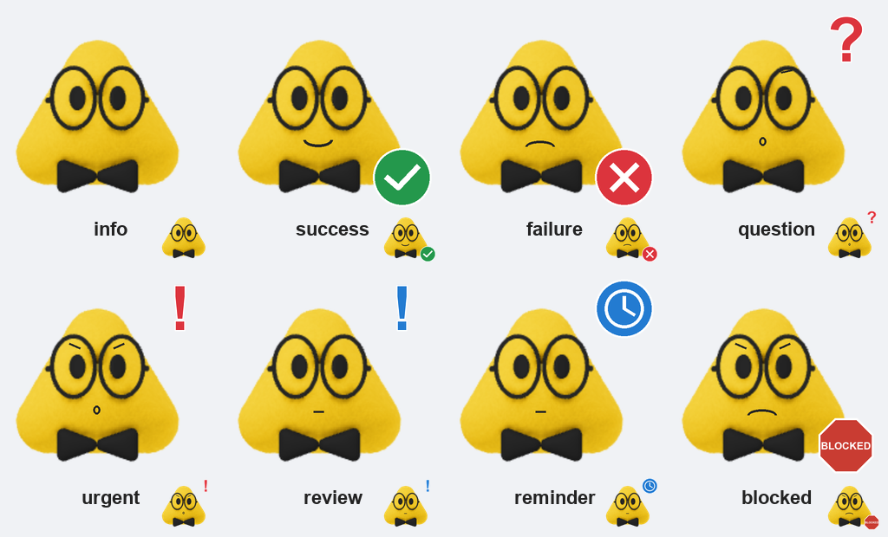
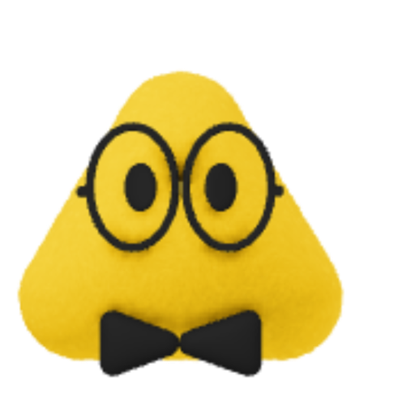
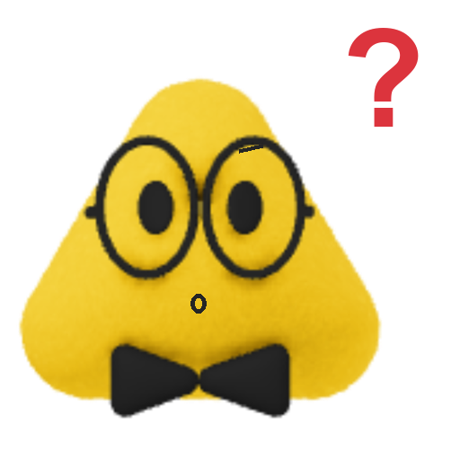
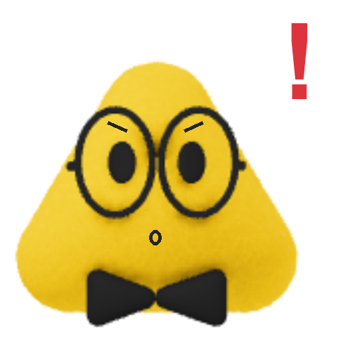
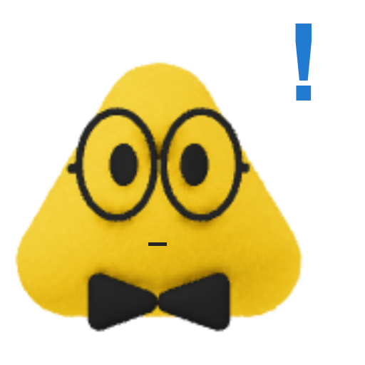
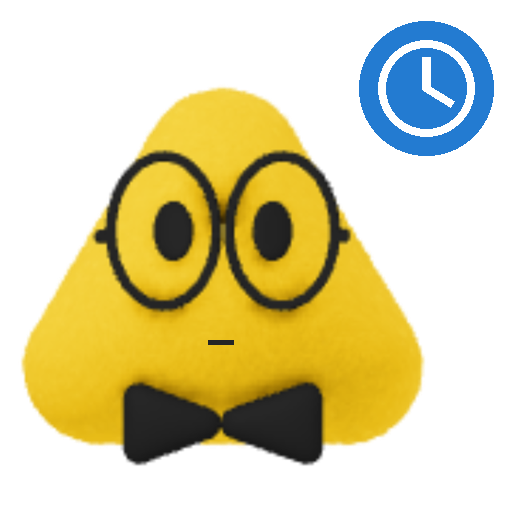

# C.A.S.E. notification icons

A consistent family of transparent notification icons for the Bark iOS service. This public repository hosts notification assets.



## Icons and public URLs

| Preview | Status / intended use | CDN | Raw fallback |
|---|---|---|---|
|  | Routine information and important findings | [PNG](https://cdn.jsdelivr.net/gh/Hmmmmmmmmmm/case-assets@main/logos/case-info.png) | [PNG](https://raw.githubusercontent.com/Hmmmmmmmmmm/case-assets/main/logos/case-info.png) |
|  | Successful completion | [PNG](https://cdn.jsdelivr.net/gh/Hmmmmmmmmmm/case-assets@main/logos/case-success.png) | [PNG](https://raw.githubusercontent.com/Hmmmmmmmmmm/case-assets/main/logos/case-success.png) |
|  | Failed task | [PNG](https://cdn.jsdelivr.net/gh/Hmmmmmmmmmm/case-assets@main/logos/case-failure.png) | [PNG](https://raw.githubusercontent.com/Hmmmmmmmmmm/case-assets/main/logos/case-failure.png) |
|  | Decision required | [PNG](https://cdn.jsdelivr.net/gh/Hmmmmmmmmmm/case-assets@main/logos/case-question.png) | [PNG](https://raw.githubusercontent.com/Hmmmmmmmmmm/case-assets/main/logos/case-question.png) |
|  | Critical intervention | [PNG](https://cdn.jsdelivr.net/gh/Hmmmmmmmmmm/case-assets@main/logos/case-urgent.png) | [PNG](https://raw.githubusercontent.com/Hmmmmmmmmmm/case-assets/main/logos/case-urgent.png) |
|  | Work ready for review | [PNG](https://cdn.jsdelivr.net/gh/Hmmmmmmmmmm/case-assets@main/logos/case-review.png) | [PNG](https://raw.githubusercontent.com/Hmmmmmmmmmm/case-assets/main/logos/case-review.png) |
|  | Scheduled reminder | [PNG](https://cdn.jsdelivr.net/gh/Hmmmmmmmmmm/case-assets@main/logos/case-reminder.png) | [PNG](https://raw.githubusercontent.com/Hmmmmmmmmmm/case-assets/main/logos/case-reminder.png) |
|  | Blocked job | [PNG](https://cdn.jsdelivr.net/gh/Hmmmmmmmmmm/case-assets@main/logos/case-blocked.png) | [PNG](https://raw.githubusercontent.com/Hmmmmmmmmmm/case-assets/main/logos/case-blocked.png) |

Masters are 512 × 512 RGBA PNGs. Optimized 256 px versions use `logos/256/`. CDN propagation may lag; use verified raw URLs as the initial fallback.

## Bark configuration

Preserve the existing autonomous escalation policy. Select group by required user action and level independently by urgency. Use these Bark_notifications.notify parameters:

| Occasion | icon | group | level | sound |
|---|---|---|---|---|
| Routine information | https://raw.githubusercontent.com/Hmmmmmmmmmm/case-assets/main/logos/case-info.png | Information | active | telegraph |
| Important finding | https://raw.githubusercontent.com/Hmmmmmmmmmm/case-assets/main/logos/case-info.png | Information | timeSensitive | newsflash |
| Successful completion | https://raw.githubusercontent.com/Hmmmmmmmmmm/case-assets/main/logos/case-success.png | Information | timeSensitive | fanfare |
| Work ready for review | https://raw.githubusercontent.com/Hmmmmmmmmmm/case-assets/main/logos/case-review.png | Review | timeSensitive | fanfare |
| Decision required | https://raw.githubusercontent.com/Hmmmmmmmmmm/case-assets/main/logos/case-question.png | Action Needed | timeSensitive | bell |
| Job blocked | https://raw.githubusercontent.com/Hmmmmmmmmmm/case-assets/main/logos/case-blocked.png | Action Needed | timeSensitive | alarm |
| Task failed | https://raw.githubusercontent.com/Hmmmmmmmmmm/case-assets/main/logos/case-failure.png | Action Needed if intervention required; otherwise Information | context-dependent | alarm |
| Critical intervention | https://raw.githubusercontent.com/Hmmmmmmmmmm/case-assets/main/logos/case-urgent.png | Action Needed | critical | horn |
| Scheduled reminder | https://raw.githubusercontent.com/Hmmmmmmmmmm/case-assets/main/logos/case-reminder.png | Reminders | context-dependent | chime |

For critical alerts, set volume=10. Resolve context-dependent levels using the existing escalation policy. Do not add device keys to this configuration.

Example invocation parameters for `Bark_notifications.notify` (merge with the connected tool's required title/body fields):

```json
{
  "title": "C.A.S.E.",
  "body": "Work is ready for review.",
  "icon": "https://raw.githubusercontent.com/Hmmmmmmmmmm/case-assets/main/logos/case-review.png",
  "group": "Review",
  "level": "timeSensitive",
  "sound": "fanfare"
}
```

## Method and validation

Deterministic Pillow composition uses the user-supplied original as an immutable source. Every icon uses the same resized mascot, with separate small mouth/eyebrow and status overlays. No generative model was used; image-gen-2.5 was not selectable through the available tool. The original body, eyes, glasses, color, orientation and bow tie are preserved.

Rebuild with Python and Pillow: `python3 sources/compose.py`. The script uses Arial Bold on macOS, with DejaVu Sans Bold as fallback. Exact typography requires the same font. `sources/validation.json` records dimensions and sizes. All 16 PNG exports were decoded, checked for RGBA encoding, requested dimensions and transparent corners. The contact sheet includes 64 px previews and was visually inspected for symbol, expression, geometry and cropping consistency. BLOCKED is readable at master sizes; its seven-letter label is very small at 64 px, where the stop-sign shape carries the status.

Original mascot supplied by the user; retained in `sources/case-original.png`. No copyright ownership claim or third-party license is assigned. No Bark device keys or credentials are included.
